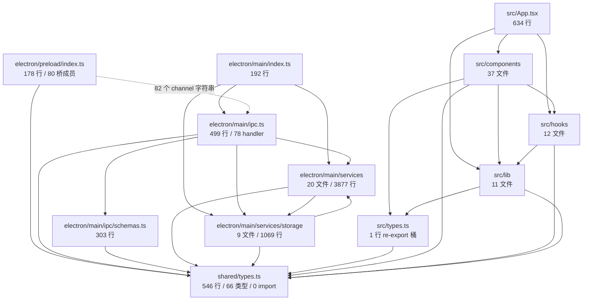

# Gitool 架构评审 · 结构事实基线

> **本文档为架构评审事实基线，不含改进建议（改进建议见 layering/security 报告）。**

| 项 | 值 |
| --- | --- |
| 仓库 | `D:\github\gitool` |
| 技术栈 | Electron + Vite + React + TypeScript（桌面应用，单人项目） |
| 评审范围 | `electron/main/`、`electron/preload/`、`src/`、`shared/`（只读） |
| 评审方法 | 全量枚举 + 静态 import 图解析 + 逐通道比对；未运行应用、未运行测试 |
| 证据约定 | 所有结论附 `相对路径:行号`；无法确认的标注「未验证」 |
| 明确排除 | `package.json` / `tsconfig*` / `vite.config.ts` / `electron-builder.yml` 的配置结论（另一任务负责），本文仅在解释启动链时只读引用 `package.json:9` 的 `main` 字段 |
| 生成时间 | 2026-11-21 |

---

## 0. 核对摘要（先摆数字）

| 核对项 | 数字 | 核对方式 |
| --- | --- | --- |
| `ipcMain.handle` 注册数 | **78** | 对 `electron/main/ipc.ts` 全文正则 `ipcMain.handle\(` 计数，去重后仍 78（通道名无重复） |
| preload 桥成员数 | **80**（76 个 `invoke` + 4 个事件订阅） | 解析 `electron/preload/index.ts:54-176` 的对象键 |
| 主进程 → 渲染层事件通道 | **4** | `notifyRenderer` / `webContents.send` 全量检索 |
| 本文 IPC 清单条数 | **78 + 4** = 82（invoke 78 条 + 事件 4 条，分两表列出） | 见第三节表格序号，逐行对照 `ipc.ts` 行号 |
| 无 preload 暴露的 handler | **2**（`tasks:updateRun`、`operations:record`） | 78 − 76 = 2 |
| 源码 ts/tsx 文件总数 | **120**（非测试 99 + 测试 21） | 递归枚举，排除 `node_modules`/`dist`/`dist-electron`/`coverage` |
| 相对 import 边（运行时非 type） | **275** | 逐文件解析相对路径 import，排除 `import type` |
| 模块级循环依赖 | **0** | 对 275 条边做 DFS 回溯检测，去重后 0 环 |
| `shared/types.ts` | 546 行 / 66 个 `export type` 或 `interface` / 0 个 import | 全文正则统计 |
| 直接依赖 `shared/types.ts` 的非测试文件 | **41**（主进程 24 + 渲染层 17） | 逐文件匹配 import 路径 |
| 经 `src/types.ts` 桶间接依赖 | **29** | 同上，匹配 `../types` 等桶路径 |
| 渲染层直接 import `electron` / `node:*` | **0** | 对 `src/` 全文检索，零命中 |

---

## 1. 物理结构与职责

### 1.1 顶层目录

```text
D:\github\gitool
├── electron/
│   ├── main/            # 主进程（Node/Electron 特权侧）
│   └── preload/         # 预加载脚本（唯一 contextBridge 出口）
├── src/                 # 渲染进程（React SPA）
│   ├── components/      # 视图与展示组件（含 detail/git/settings/tasks 四个子域）
│   ├── hooks/           # 领域状态与用例编排
│   └── lib/             # 纯函数 / 浏览器侧工具 / 桥访问器
├── shared/
│   └── types.ts         # 跨进程唯一契约层
├── index.html           # 渲染进程 HTML 入口
├── docs/                # 评审与运维文档
└── build/, public/      # 静态资源（图标等）
```

### 1.2 目录职责与规模（非测试口径）

| 目录 | 非测试文件 | 测试文件 | 非测试行数 | 职责（事实描述） | 证据 |
| --- | --- | --- | --- | --- | --- |
| `electron/main/`（根） | 2 | 0 | 691 | 应用生命周期、窗口、托盘、单实例锁、退出回收；`ipc.ts` 为全部 handler 注册点 | `electron/main/index.ts:81-192`、`electron/main/ipc.ts:125-415` |
| `electron/main/ipc/` | 1 | 1 | 303 | IPC 入参 zod schema 与 `parseOrThrow`；仅被 `ipc.ts` 引用 | `electron/main/ipc/schemas.ts`、`electron/main/ipc.ts:88-119` |
| `electron/main/services/` | 20 | 6 | 3877 | 主进程业务服务：git 执行/解析、远端平台 API、任务进程、备份、AI、环境体检、安装、更新、凭证、进程回收、CSV | 见 1.3 清单 |
| `electron/main/services/storage/` | 9 | 9 | 1069 | SQLite 持久化：连接与 schema、9 个数据域的 DML | 见第七节 |
| `electron/preload/` | 1 | 0 | 178 | `contextBridge.exposeInMainWorld("gitool", bridge)`，把 78 个通道收窄为 80 个白名单方法 | `electron/preload/index.ts:54`、`:178` |
| `src/`（根） | 5 | 0 | 657 | `App.tsx`（634 行，全局状态与视图切换）、`main.tsx`（挂载）、`types.ts`（桶）、`electron.d.ts`（`window.gitool` 声明）、`vite-env.d.ts` | `src/main.tsx:6`、`src/App.tsx:35`、`src/types.ts:1` |
| `src/components/`（根） | 16 | 0 | 3071 | 7 个 Workspace 级页面 + 项目列表/详情装配 + 复用展示组件 | 见 1.4 |
| `src/components/detail/` | 7 | 0 | 639 | 项目详情右栏：总览、Git 面板、分析、README、别名/标签编辑、未克隆面板 | `src/components/ProjectDetail.tsx:16-20` |
| `src/components/git/` | 6 | 0 | 967 | Git 四个 Tab（变更/分支/历史/标签）+ 时间线渲染 + 加载序号守卫 | 四个 Tab 由 `src/components/GitActionsPanel.tsx:4-7` 装配 |
| `src/components/settings/` | 5 | 0 | 639 | 设置四个页签（账号/应用/AI/环境） | `src/components/SettingsWorkspace.tsx:13-16` |
| `src/components/tasks/` | 3 | 0 | 442 | 任务表单、任务配置列表、运行历史列表 | `src/components/TasksWorkspace.tsx:6-8` |
| `src/hooks/` | 12 | 1 | 1872 | 12 个领域 hook + `useAsyncData` 异步加载基座 | 见 1.5 |
| `src/lib/` | 11 | 4 | 565 | 桥访问器、纯格式化、markdown 安全渲染、导航/元数据、项目匹配、localStorage 读写、UI 偏好、并发工具 | 见 1.6 |
| `shared/` | 1 | 0 | 546 | 跨进程 DTO 与 `DesktopBridge` 接口定义（纯类型，无运行时 import） | `shared/types.ts:1-546` |
| `src/styles.css` | 1 | — | 3319 | 全局样式单文件（无 CSS Module / 组件级样式） | `src/main.tsx:4` |

### 1.3 `electron/main/services` 文件清单（20 个非测试文件）

| 文件 | 行数 | 导出（去参数） | 职责 |
| --- | --- | --- | --- |
| `git.ts` | 991 | `inspectLocalProject, initRepository, scanDirectoryForRepositories, getFileDiff, setRemoteUrl, listTags, createTag, deleteTag, listVersions, compareVersions, getProjectSnapshot, runGitOperation, listChangedFiles, stageFiles, unstageFiles, commitChanges, listBranches, createBranch, switchBranch, deleteBranch, listCommitHistory, revertCommit, cloneRepository, getDiskSize, readProjectReadme, moveProject, invalidateDiskSizeCache, getActiveGitBinary` | 全部 git 子命令执行、文件系统克隆/移动、进度推送；依赖 `node:child_process` + `node:fs`（`git.ts:1-15`） |
| `gitParsing.ts` | 256 | `isValidRefName, isValidCommitHash, parseChangeStatus, bracketValue, parseCloneProgress, parseCommitHistory, buildCommitMessageArgs, parseStatusPorcelainZ, parseNumstatPaths, toLiteralPathspec, parseBranchLine` | git 输出的纯解析层（可单测） |
| `providers.ts` | 753 | `resolveTokenUser, testAccount, loadRemoteRepositories, loadCachedRemoteRepositories, searchRemoteRepositories, toggleRepositoryInteraction, createRemoteRepository, updateRemoteRepository, deleteRemoteRepository` | GitHub/Gitee/GitLab REST API 客户端 |
| `commandDetection.ts` | 395 | `detectProjectCommands` | 按项目清单/构建文件推断可运行命令 |
| `setup.ts` | 233 | `installGit` | 下载 Git 安装包并以 UAC 提权安装，进度经事件推送（`setup.ts:35`） |
| `analysis.ts` | 186 | `analyzeProject, invalidateAnalysisCache` | 目录遍历统计语言/体积/文件数，带 30s 缓存（`analysis.ts:6-14`） |
| `updater.ts` | 152 | `getUpdateDirectory, isTrustedInstallerPath, checkForUpdates, downloadUpdate, installUpdate` | 自更新：检查/下载/安装 |
| `tasks.ts` | 150 | `runTask, stopTask, isTaskRunning, getRunningTaskOutput` | 用户自定义命令的子进程生命周期与输出缓冲（256KB 截断） |
| `backups.ts` | 139 | `createBackup, restoreBackup` | 基于 `tar` 的项目备份与恢复 |
| `ai.ts` | 128 | `generateAiSummary, readStoredApiKey, saveAiApiKey, deleteAiApiKey, hasStoredApiKey` | OpenAI 兼容接口调用 + Key 存取 |
| `environment.ts` | 83 | `getEnvironmentStatus` | Git 可用性、数据目录可写性、网络探测 |
| `commandLine.ts` | 83 | `splitCommandLine, quoteWindowsArg` | Windows 命令行拆分/转义（`shell:true` 场景） |
| `processCleanup.ts` | 78 | `registerProcessStopper, killAllProcesses, getTrackedProcessCount, killProcessTree` | 子进程登记与 `taskkill /T /F` 回收 |
| `openers.ts` | 51 | `openInEditor, openInTerminal` | 外部编辑器/终端启动 |
| `credentials.ts` | 50 | `saveCredential, readCredential, deleteCredential, probeKeyring` | 系统钥匙串读写凭证 |
| `version.ts` | 42 | `compareVersions` | 版本号比较 |
| `operationCsv.ts` | 37 | `csvEscape, buildOperationRecordsCsv` | 操作日志 CSV 生成 |
| `concurrency.ts` | 31 | `mapLimit` | 并发限流 map |
| `serviceUtils.ts` | 30 | `errorMessage, assertDirectory` | 服务层公共工具 |
| `events.ts` | 9 | `notifyRenderer` | 向所有未销毁窗口广播事件（`events.ts:3-9`） |

### 1.4 `src/components` 清单（36 个 .tsx + 1 个 .ts，共 40 个导出组件）

根目录（16 文件 / 3071 行）：

| 文件 | 行数 | 导出 | 职责 |
| --- | --- | --- | --- |
| `RemoteRepositoriesWorkspace.tsx` | 459 | `RemoteRepositoriesWorkspace` | 远端仓库浏览页 |
| `ProjectsWorkspace.tsx` | 349 | `ProjectsWorkspace` | 项目列表 + 右侧详情分栏主视图；props 已收敛为 4 个「域对象」（`ProjectsWorkspace.tsx:23-27`） |
| `TasksWorkspace.tsx` | 314 | `TasksWorkspace` | 任务配置/运行页（直连桥 `TasksWorkspace.tsx:36`） |
| `GitActionsPanel.tsx` | 227 | `GitActionsPanel` | 克隆地址/远程 URL 等 Git 快捷操作 |
| `SettingsWorkspace.tsx` | 216 | `SettingsWorkspace` | 设置页外壳，挂 4 个子页签（`SettingsWorkspace.tsx:13-16`） |
| `common.tsx` | 214 | `MetricCard, FilterButton, ProjectRow, EmptyProjects, AnalysisMetric, GitOperationButton, DetailStat` | 跨页复用展示组件 |
| `RemoteRepositorySearch.tsx` | 196 | `RemoteRepositorySearch` | 远端仓库搜索（直连桥 `:20`） |
| `ProjectDetail.tsx` | 192 | `ProjectDetail` | 项目详情容器，装配 `detail/*` 与 `git/*` |
| `LogsWorkspace.tsx` | 172 | `LogsWorkspace` | 操作日志页 |
| `BackupsWorkspace.tsx` | 169 | `BackupsWorkspace` | 备份页 |
| `OverviewWorkspace.tsx` | 165 | `OverviewWorkspace` | 总览页 |
| `WorkspaceSwitcher.tsx` | 154 | `WorkspaceSwitcher` | 工作区切换器 |
| `ProjectsPage.tsx` | 118 | `ProjectsPage` | 「我的项目」页编排层：自持筛选域与 Git 操作域，装配 `ProjectsWorkspace`（`ProjectsPage.tsx:12-27`） |
| `ReadmeOverlay.tsx` | 62 | `ReadmeOverlay` | README 弹层 |
| `AttentionPanel.tsx` | 54 | `AttentionPanel` | 总览页提醒卡片 |
| `providerIcons.ts` | 10 | `providerIcons` | 平台图标映射（唯一非 tsx 文件） |

子目录：

| 目录 | 文件 | 内容 |
| --- | --- | --- |
| `detail/`（7 / 639 行） | `OverviewPanel.tsx`(269)、`GitTabPanel.tsx`(87)、`UnclonedProjectPanel.tsx`(74)、`AliasEditor.tsx`(63)、`ProjectAnalysisPanel.tsx`(55)、`ReadmeSection.tsx`(46)、`TagEditor.tsx`(45) | 详情右栏分面板 |
| `git/`（6 / 967 行） | `HistoryTab.tsx`(282)、`ChangesTab.tsx`(264)、`BranchesTab.tsx`(181)、`TagsTab.tsx`(162)、`CommitTimeline.tsx`(59)、`loadSequence.ts`(19) | Git 四 Tab + 加载竞态守卫 |
| `settings/`（5 / 639 行） | `EnvironmentTab.tsx`(190)、`AppSettingsTab.tsx`(157)、`AccountsWorkspace.tsx`(124)、`AiSettingsTab.tsx`(108)、`AccountRow.tsx`(60) | 设置子页签 |
| `tasks/`（3 / 442 行） | `TaskForm.tsx`(243)、`TaskProfilesList.tsx`(108)、`TaskRunsList.tsx`(91) | 任务子组件 |

### 1.5 `src/hooks` 清单（12 非测试 + 1 测试）

| 文件 | 行数 | 职责 | 是否直接访问桥 |
| --- | --- | --- | --- |
| `useRemotes.ts` | 428 | 远端仓库加载/缓存/克隆/搜索/交互（最大 hook） | 是（`:111`、`:292`、`:383`） |
| `useImportFlow.ts` | 240 | 导入/初始化/目录扫描流程 | 是（`:38`、`:105`、`:163`、`:213`） |
| `useProjects.ts` | 218 | 项目列表 CRUD/收藏/移动/刷新、串行化持久化队列 | 是（`:80`、`:148`、`:179`） |
| `useGitOperations.ts` | 183 | Git 操作执行与结果状态、结构分析触发 | 是（`:77`、`:116`） |
| `useAsyncData.ts` | 165 | 通用异步加载基座（`createAsyncDataCore` + `useAsyncData`），被 4 个 Workspace 复用 | 否 |
| `useWorkspaces.ts` | 137 | 工作区切换/增删改，桌面走 IPC、Web 走 localStorage | 是（`:55`、`:72`） |
| `useAccounts.ts` | 112 | 账号增删测 | 是（`:36`、`:65`、`:97`） |
| `useSplitWidth.ts` | 109 | 分栏宽度拖拽与 localStorage 记忆 | 否 |
| `useEnvironment.ts` | 99 | 环境体检、Git 安装进度订阅 | 是（`:34`、`:62`、`:72`） |
| `useUpdater.ts` | 86 | 更新检查/下载/安装与事件订阅 | 是（`:30`、`:42`、`:59`、`:74`） |
| `useNotice.ts` | 49 | 全局提示条 | 否 |
| `useReadme.ts` | 46 | README 读取与状态 | 是（`:19`） |

### 1.6 `src/lib` 清单（11 非测试 + 4 测试）

| 文件 | 行数 | 导出 | 职责 |
| --- | --- | --- | --- |
| `bridge.ts` | 20 | `getDesktopBridge, isDesktopRuntime, requireDesktopBridge` | **渲染层唯一桥访问入口**；直接读 `window.gitool`（`bridge.ts:7`） |
| `workspaces.ts` | 108 | `DEFAULT_WORKSPACE_ID, listWorkspaces, createWorkspace, renameWorkspace, deleteWorkspace, projectStorageKey` | Web 模式工作区 localStorage 实现 |
| `projects.ts` | 37 | `loadProjects, saveProjects` | Web 模式项目 localStorage 实现（含 legacy key 迁移 `:28-37`） |
| `markdown.ts` | 83 | `escapeHtml, renderMarkdownSafe` | Markdown 安全渲染 |
| `navigation.ts` | 67 | `buildNavGroups, workspaceLabel` | 侧栏导航分组 |
| `format.ts` | 63 | `formatBytes, isDormant, formatCommitDate, formatDayGroup` | 纯格式化（有单测） |
| `meta.ts` | 53 | `statusMeta, providerLabels, operationLabels, remoteProviderLabels, changeStatusMeta` | 展示元数据映射 |
| `projectMatch.ts` | 53 | `remoteMatchKeys, remoteProjectMatch, projectFromSnapshot` | 远端仓库与本地项目匹配（有单测） |
| `uiPrefs.ts` | 42 | 字号常量 + `loadFontScale, saveFontScale, applyFontScale` | UI 偏好 |
| `concurrency.ts` | 29 | `mapWithConcurrency` | 渲染侧并发工具 |
| `storageKeys.ts` | 10 | 3 个 localStorage key 常量 | 键集中定义 |
---

## 2. 入口与启动链

### 2.1 主进程启动顺序（`electron/main/index.ts`）

| 顺序 | 动作 | 证据 |
| --- | --- | --- |
| 1 | 模块加载即申请单实例锁；未获得则 `app.quit()`，不注册任何 handler | `index.ts:155-158` |
| 2 | 注册 `second-instance`（聚焦已有窗口）与 `before-quit`（统一回收子进程 + 销毁托盘） | `index.ts:160-168` |
| 3 | `app.whenReady()` 后：`setAppUserModelId` → **`registerIpcHandlers()`** → `createMainWindow()` → `createTray()` → 首次更新检查 + 定时器 | `index.ts:170-176` |
| 4 | 注册 `activate`（无窗口时重建）与 `window-all-closed`（非 darwin 退出） | `index.ts:178-191` |
| 5 | 真实退出路径统一收口到 `runShutdownCleanup()`：清定时器 → `killAllProcesses()` → 销毁托盘 | `index.ts:34-45`、`:168` |

关键顺序事实：**IPC handler 先于窗口创建注册**（`index.ts:172` 早于 `:173`），渲染进程首次 `invoke` 不会命中缺失 handler。

### 2.2 BrowserWindow 创建位置与 preload 挂载

| 事实 | 证据 |
| --- | --- |
| 唯一创建点：`createMainWindow()`（`activate` 分支复用） | `index.ts:81`、`:180` |
| 窗口参数：1440×900，`show: false`，`autoHideMenuBar: true` | `index.ts:83-92` |
| preload 路径：`join(__dirname, "preload.cjs")` | `index.ts:94` |
| 安全开关现值：`contextIsolation: true` / `nodeIntegration: false` / `sandbox: true` / `webSecurity: true` | `index.ts:93-99`（仅陈述现状，安全性判定见 security 报告） |
| 首帧显示：`ready-to-show` → `show()`；加载失败仅打日志 | `index.ts:102`、`:106-108` |
| 关闭行为：实时读 SQLite 设置 `closeToTray`，失败回退默认退出 | `index.ts:117-129` |
| 外链与导航：`setWindowOpenHandler` 仅放行 http(s) 到系统浏览器；`will-navigate` 仅允许 dev server | `index.ts:132-144` |
| 装载内容：dev 用 `VITE_DEV_SERVER_URL`，否则 `loadFile(join(__dirname, "../dist/index.html"))` | `index.ts:146-150` |

### 2.3 渲染进程入口链（实际存在的一条链路）

```text
package.json:9  main = dist-electron/main.cjs
  → electron/main/index.ts:81 createMainWindow()
  → index.ts:94  webPreferences.preload = dist-electron/preload.cjs
  → index.ts:147/149 loadURL(dev) | loadFile(dist/index.html)
  → index.html:13 <script type="module" src="/src/main.tsx">
  → src/main.tsx:6  createRoot(#root).render(<StrictMode><App/></StrictMode>)
  → src/App.tsx:35 function App()
  → App.tsx:430-486 按 workspace 状态渲染 7 个 Workspace 组件
```

补充事实：

- `index.html:8` 存在占位注释 `<!--CSP-->`；其注入实现属构建配置，**未验证**（交 security 报告）。
- `App.tsx` 的视图切换是**条件渲染**（`workspace === "overview" | "projects" | "remotes" | "tasks" | "backups" | "logs" | "settings"`），无路由库、无 URL 同步：`App.tsx:430-486`。
- `src/electron.d.ts:5` 以 `Window.gitool?: DesktopBridge` 声明桥；`src/lib/bridge.ts:7` 是唯一读取点。

### 2.4 关闭/退出链（与结构相关的事实）

| 路径 | 行为 | 证据 |
| --- | --- | --- |
| 托盘「隐藏到托盘」 | 仅 `window.hide()`，进程与子任务保留 | `index.ts:59` |
| X 关闭 + `closeToTray=true` | `preventDefault()` + `hide()` | `index.ts:123-128` |
| X 关闭 + `closeToTray=false` | 放行 → `window-all-closed` → `app.quit()` → `before-quit` 回收 | `index.ts:129`、`:185-191` |
| 托盘「退出」/ 安装更新 | `app.quit()` → `before-quit` → 杀全部在册子进程 | `index.ts:47-50`、`:34-45` |

---

## 3. 完整 IPC 通道清单

### 3.1 结构与核对方法

IPC 由三层字符串构成，**三处各自硬编码，无共享常量/枚举**：

1. 主进程注册：`electron/main/ipc.ts` 内 `ipcMain.handle("<channel>", ...)`，78 处；
2. preload 白名单：`electron/preload/index.ts:54-176` 定义 `DesktopBridge` 对象，76 个 `invoke` + 4 个 `ipcRenderer.on`；
3. 主进程推送：`electron/main/services/events.ts:3-9` 的 `notifyRenderer(channel, payload)`（channel 为 `string` 形参）与两处直接 `webContents.send`（`index.ts:12`、`ipc.ts:400`）。

核对结果：**78 个 handler 中 76 个有 preload 方法，2 个没有**（`tasks:updateRun`、`operations:record`，见 3.4）。

### 3.2 invoke 通道全量清单（78 条，按 handler 注册行号排序）

「校验」列仅记录现状事实（schema 名 / `requireString` / 手写），**不评价其充分性**。

| # | channel | handler 位置 `ipc.ts:` | 入参校验（现状） | preload 方法:行 | 渲染层调用点 |
| --- | --- | --- | --- | --- | --- |
| 1 | `system:environment` | 126 | 无入参 | `environment` :55 | `src/App.tsx:232` |
| 2 | `system:refreshEnvironment` | 129 | 无入参 | `refreshEnvironment` :56 | `src/hooks/useEnvironment.ts:62` |
| 3 | `system:installGit` | 132 | 无入参 | `installGit` :57 | `src/hooks/useEnvironment.ts:72` |
| 4 | `system:selectDirectory` | 134 | 手写 `typeof === "string"` | `selectDirectory` :67 | `settings/AppSettingsTab.tsx:29`；`BackupsWorkspace.tsx:38,64`；`LogsWorkspace.tsx:54`；`useImportFlow.ts:41,106,214`；`useProjects.ts:180`；`useRemotes.ts:294` |
| 5 | `shell:openExternal` | 148 | 手写 `/^https?:\/\//i` | `openExternal` :68 | `detail/UnclonedProjectPanel.tsx:60`；`RemoteRepositoriesWorkspace.tsx:134`；`RemoteRepositorySearch.tsx:49,91` |
| 6 | `shell:openPath` | 155 | `requireString` | `openPath` :69 | `detail/OverviewPanel.tsx:85` |
| 7 | `shell:openEditor` | 163 | `openEditorInputSchema` | `openInEditor` :70 | `detail/OverviewPanel.tsx:54` |
| 8 | `shell:openTerminal` | 167 | `requireString` | `openInTerminal` :71 | `detail/OverviewPanel.tsx:67` |
| 9 | `projects:inspect` | 171 | `requireString` | `inspectProject` :72 | `useImportFlow.ts:52,118,130,173`；`useRemotes.ts:310` |
| 10 | `projects:snapshot` | 174 | `requireString` | `getProjectSnapshot` :73 | `useProjects.ts:152` |
| 11 | `projects:analyze` | 177 | `requireString` | `analyzeProject` :74 | `useGitOperations.ts:166` |
| 12 | `projects:detectCommands` | 180 | `requireString` | `detectProjectCommands` :75 | `components/TasksWorkspace.tsx:79` |
| 13 | `projects:diskSize` | 183 | `requireString` | `getDiskSize` :76 | `detail/OverviewPanel.tsx:102`；`useImportFlow.ts:64,131,175`；`useProjects.ts:153`；`useRemotes.ts:312` |
| 14 | `projects:readme` | 186 | `requireString` | `readProjectReadme` :77 | `detail/OverviewPanel.tsx:100`；`useReadme.ts:28` |
| 15 | `projects:init` | 189 | `initRepositoryInputSchema` | `initRepository` :140 | `useImportFlow.ts:129` |
| 16 | `projects:scanDirectory` | 192 | `requireString` | `scanDirectoryForRepositories` :141 | `useImportFlow.ts:217` |
| 17 | `projects:fileDiff` | 195 | `fileDiffRequestSchema` | `getFileDiff` :143 | `git/ChangesTab.tsx:63` |
| 18 | `projects:setRemoteUrl` | 198 | `setRemoteUrlInputSchema` | `setRemoteUrl` :145 | `GitActionsPanel.tsx:93` |
| 19 | `git:tags` | 201 | `requireString` | `listTags` :146 | `git/TagsTab.tsx:54` |
| 20 | `git:createTag` | 204 | `createTagInputSchema` | `createTag` :147 | `git/TagsTab.tsx:84` |
| 21 | `git:deleteTag` | 207 | `requireString` ×2 | `deleteTag` :148 | `git/TagsTab.tsx:105` |
| 22 | `git:listVersions` | 210 | `requireString` | `listVersions` :149 | `git/HistoryTab.tsx:91` |
| 23 | `git:compareVersions` | 213 | `compareRequestSchema` | `compareVersions` :150 | `git/HistoryTab.tsx:147` |
| 24 | `projects:gitOperation` | 216 | `requireString` + `gitOperationSchema` | `runGitOperation` :78 | `useGitOperations.ts:77,127` |
| 25 | `projects:clone` | 219 | `cloneRepositoryInputSchema`（经 `recordClone`） | `cloneRepository` :80 | `useRemotes.ts:300` |
| 26 | `git:changedFiles` | 220 | `requireString` | `listChangedFiles` :90 | `git/ChangesTab.tsx:77` |
| 27 | `git:stageFiles` | 223 | `requireString` + `requireStringArray` | `stageFiles` :91 | `git/ChangesTab.tsx:112,149` |
| 28 | `git:unstageFiles` | 226 | `requireString` + `requireStringArray` | `unstageFiles` :92 | `git/ChangesTab.tsx:110` |
| 29 | `git:commit` | 229 | `commitRequestSchema`（经 `recordCommit`） | `commitChanges` :93 | `git/ChangesTab.tsx:126` |
| 30 | `git:branches` | 230 | `requireString` | `listBranches` :94 | `git/BranchesTab.tsx:53` |
| 31 | `git:createBranch` | 233 | `createBranchInputSchema` | `createBranch` :95 | `git/BranchesTab.tsx:80` |
| 32 | `git:switchBranch` | 236 | `switchBranchInputSchema` | `switchBranch` :96 | `git/BranchesTab.tsx:94` |
| 33 | `git:deleteBranch` | 239 | `deleteBranchInputSchema` | `deleteBranch` :97 | `git/BranchesTab.tsx:110` |
| 34 | `git:history` | 242 | `requireString` | `listCommitHistory` :98 | `detail/OverviewPanel.tsx:101`；`git/HistoryTab.tsx:74`；`GitActionsPanel.tsx:62` |
| 35 | `git:revert` | 245 | `revertCommitInputSchema` | `revertCommit` :99 | `git/HistoryTab.tsx:133` |
| 36 | `projects:load` | 248 | `requireString` | `loadProjects` :100 | `useWorkspaces.ts:55`；`App.tsx:245` |
| 37 | `projects:save` | 251 | `requireString` + `projectsSchema` | `saveProjects` :101 | `useProjects.ts:80` |
| 38 | `workspaces:list` | 258 | 无入参 | `listWorkspaces` :102 | `src/App.tsx:231` |
| 39 | `workspaces:create` | 259 | `createWorkspaceInputSchema` | `createWorkspace` :103 | `useWorkspaces.ts:72` |
| 40 | `workspaces:rename` | 262 | `renameWorkspaceInputSchema` | `renameWorkspace` :104 | `useWorkspaces.ts:89` |
| 41 | `workspaces:delete` | 265 | `requireString` | `deleteWorkspace` :105 | `useWorkspaces.ts:110` |
| 42 | `accounts:load` | 269 | 无入参 | `loadAccounts` :106 | `src/App.tsx:233` |
| 43 | `accounts:create` | 270 | `createAccountInputSchema` | `createAccount` :107 | `useAccounts.ts:36` |
| 44 | `accounts:test` | 276 | `requireString` | `testAccount` :108 | `useAccounts.ts:65` |
| 45 | `accounts:delete` | 279 | `requireString` | `deleteAccount` :109 | `useAccounts.ts:97` |
| 46 | `remoteRepositories:load` | 282 | `requireString` | `loadRemoteRepositories` :110 | `useRemotes.ts:124` |
| 47 | `remoteRepositories:loadCached` | 285 | `requireString` | `loadCachedRemoteRepositories` :112 | `useRemotes.ts:117` |
| 48 | `remoteRepositories:cacheMeta` | 290 | `requireString` | `getRemoteRepositoryCacheMeta` :114 | `useRemotes.ts:121,127` |
| 49 | `remoteRepositories:create` | 293 | `remoteRepositoryWriteInputSchema` | `createRemoteRepository` :119 | `useRemotes.ts:386` |
| 50 | `remoteRepositories:update` | 296 | `remoteRepositoryWriteInputSchema` | `updateRemoteRepository` :121 | `useRemotes.ts:388` |
| 51 | `remoteRepositories:delete` | 299 | `requireString` ×2 | `deleteRemoteRepository` :123 | `useRemotes.ts:389` |
| 52 | `remoteRepositories:search` | 305 | `remoteRepositorySearchInputSchema` | `searchRemoteRepositories` :116 | `RemoteRepositorySearch.tsx:64` |
| 53 | `remoteRepositories:interact` | 313 | `repositoryInteractionInputSchema` | `toggleRepositoryInteraction` :118 | `useRemotes.ts:199,271` |
| 54 | `tasks:listProfiles` | 322 | 无入参 | `listTaskProfiles` :125 | `components/TasksWorkspace.tsx:55` |
| 55 | `tasks:saveProfile` | 323 | `taskProfileSchema` | `saveTaskProfile` :126 | `components/TasksWorkspace.tsx:173` |
| 56 | `tasks:deleteProfile` | 326 | `requireString` | `deleteTaskProfile` :127 | `components/TasksWorkspace.tsx:204` |
| 57 | `tasks:run` | 329 | `requireString` | `runTask` :128 | `components/TasksWorkspace.tsx:191` |
| 58 | `tasks:stop` | 334 | `requireString` | `stopTask` :129 | `components/TasksWorkspace.tsx:212` |
| 59 | `tasks:listRuns` | 337 | 无入参 | `listTaskRuns` :130 | `components/TasksWorkspace.tsx:56` |
| 60 | `tasks:getRunningOutput` | 338 | `requireString` | `getRunningTaskOutput` :144 | `components/TasksWorkspace.tsx:109` |
| 61 | `tasks:updateRun` | 341 | `taskRunSchema` | **无** | **无**（见 3.4） |
| 62 | `backups:list` | 346 | 无入参 | `listBackups` :131 | `BackupsWorkspace.tsx:26` |
| 63 | `backups:create` | 347 | `backupCreateInputSchema` | `createBackup` :132 | `BackupsWorkspace.tsx:42` |
| 64 | `backups:restore` | 350 | `backupRestoreInputSchema` | `restoreBackup` :133 | `BackupsWorkspace.tsx:66` |
| 65 | `operations:list` | 354 | 无入参 | `listOperationRecords` :134 | `LogsWorkspace.tsx:23` |
| 66 | `operations:clear` | 355 | 无入参 | `clearOperationRecords` :135 | `LogsWorkspace.tsx:45` |
| 67 | `operations:export` | 356 | `requireString` | `exportOperationRecords` :136 | `LogsWorkspace.tsx:56` |
| 68 | `operations:record` | 359 | `operationRecordSchema` | **无** | **无**（见 3.4） |
| 69 | `settings:load` | 363 | 无入参 | `loadSettings` :137 | `detail/OverviewPanel.tsx:103`；`BackupsWorkspace.tsx:37`；`SettingsWorkspace.tsx:85`；`App.tsx:234` |
| 70 | `settings:save` | 364 | `appSettingsSchema` | `saveSettings` :138 | `SettingsWorkspace.tsx:105` |
| 71 | `projects:move` | 367 | `moveProjectInputSchema` | `moveProject` :139 | `ProjectsWorkspace.tsx:295`（经 `useProjects.ts:183`） |
| 72 | `ai:generateSummary` | 370 | `aiSummaryRequestSchema` | `generateAiSummary` :151 | `detail/OverviewPanel.tsx:139` |
| 73 | `ai:saveKey` | 373 | `aiSecretSchema` | `saveAiApiKey` :152 | `SettingsWorkspace.tsx:101` |
| 74 | `ai:deleteKey` | 376 | 无入参 | `deleteAiApiKey` :153 | `SettingsWorkspace.tsx:122` |
| 75 | `ai:hasKey` | 379 | 无入参 | `hasAiApiKey` :154 | `SettingsWorkspace.tsx:86` |
| 76 | `updater:check` | 381 | 无入参 | `checkForUpdates` :155 | `useUpdater.ts:45` |
| 77 | `updater:download` | 389 | 无入参（模块级 `updateDownloadInFlight` 互斥） | `downloadUpdate` :156 | `useUpdater.ts:64` |
| 78 | `updater:install` | 407 | `requireString` + `isTrustedInstallerPath` | `installUpdate` :157 | `useUpdater.ts:77` |

**核对**：本表 78 行 = `ipc.ts` 中 `ipcMain.handle` 78 处（126–407 行区间），通道名去重后仍 78，无重复注册。

### 3.3 主进程 → 渲染层事件通道（4 条）

| # | channel | 发送点 | preload 订阅方法:行 | 渲染层订阅点 |
| --- | --- | --- | --- | --- |
| E1 | `setup:installProgress` | `services/setup.ts:35` → `notifyRenderer` | `onInstallProgress` :58 | `useEnvironment.ts:34` |
| E2 | `git:cloneProgress` | `services/git.ts:653` → `notifyRenderer` | `onCloneProgress` :81 | `useRemotes.ts:69` |
| E3 | `updater:available` | `main/index.ts:12` → `window.webContents.send` | `onUpdateAvailable` :158 | `useUpdater.ts:31` |
| E4 | `updater:progress` | `main/ipc.ts:400` → `win?.webContents.send` | `onUpdateProgress` :167 | `useUpdater.ts:32` |

结构性事实：

- E1/E2 走 `notifyRenderer`（广播到 `BrowserWindow.getAllWindows()`，`events.ts:4-8`）；E3/E4 走单窗口定向发送。
- 事件名同样在「发送方 / preload / 订阅方」三处独立硬编码，`notifyRenderer` 的 channel 形参类型是 `string`（`events.ts:3`），编译期无法约束。

### 3.4 主进程内部通道（已注册但 preload 未暴露）

| channel | handler | 实际调用方式 | 说明 |
| --- | --- | --- | --- |
| `tasks:updateRun` | `ipc.ts:341` | handler 内调用 `storage/tasks.ts` 的 `updateTaskRun`；同时 `services/tasks.ts:6` 也直接调用同一函数 | preload 无对应成员 → 渲染层不可达 |
| `operations:record` | `ipc.ts:359` | handler 内调用 `insertOperationRecord`；实际写日志走 `ipc.ts:449` 的 `recordOperation()` 直调 | preload 无对应成员 → 渲染层不可达 |

即：`preload` 的 80 个成员 = 76 个 `invoke`（覆盖 76/78 handler）+ 4 个事件订阅；剩余 2 个 handler 属于**渲染层不可达通道**。
---

## 4. 依赖关系

### 4.1 渲染层是否直连 `electron` / Node 模块

**结论：没有。** 对 `src/` 全部 70 个 ts/tsx 文件检索 `from "electron"`、`from "node:*"`、`from "fs|path|child_process|os"`，**零命中**。

渲染层访问主进程的唯一合法路径是 `src/lib/bridge.ts`：

| 约束点 | 证据 |
| --- | --- |
| `window.gitool` 的唯一读取处 | `src/lib/bridge.ts:7`（`return window.gitool;`） |
| 类型来源 | `src/electron.d.ts:1-7` 引入 `shared/types` 的 `DesktopBridge` |
| 组件直接持有桥的文件 | **10 个**：`BackupsWorkspace.tsx:17`、`GitActionsPanel.tsx:35`、`LogsWorkspace.tsx:13`、`RemoteRepositoriesWorkspace.tsx:128`、`RemoteRepositorySearch.tsx:20`、`SettingsWorkspace.tsx:71`、`TasksWorkspace.tsx:36`、`detail/OverviewPanel.tsx:45`、`detail/UnclonedProjectPanel.tsx:20`、`settings/AppSettingsTab.tsx:25` |

即：没有 `ipcRenderer` 直连，但存在 **10 个组件绕过 hooks 层直接取桥**（分层事实，判定见 layering 报告）。

### 4.2 主进程与 `shared` 的双向性

| 方向 | 是否有边 | 证据 |
| --- | --- | --- |
| 主进程（含 preload） → `shared/types.ts` | 有，**24 个非测试文件**，且**全部为 `import type`**（无运行时依赖） | `ipc.ts:2-7`、`preload/index.ts:2-39`、`services/storage/database.ts:4-13` 等 |
| `shared/types.ts` → 主进程 / 渲染层 | **无**。`shared/types.ts` 全文 0 个 `import` / `export *` | `shared/types.ts`（546 行，66 个 `export type` / `interface`） |
| 渲染层 → `shared/types.ts` | 有，17 个文件直接依赖（见第五节） | 见 5.2 |

`shared` 是纯类型叶子层，**不存在双向污染**；但主进程与渲染层共用同一组 DTO（无独立领域模型），见 8.1 事实 3。

### 4.3 目录级依赖边（运行时 import，排除 `import type` 与测试）

| 源 → 目标 | 边数（文件级） | 代表证据 |
| --- | --- | --- |
| `electron/main/index.ts` → `electron/main/ipc.ts` | 1 | `index.ts:3` |
| `electron/main/index.ts` → `electron/main/services` | 2 | `index.ts:4-5`（updater、processCleanup） |
| `electron/main/index.ts` → `electron/main/services/storage` | 1 | `index.ts:6`（settings） |
| `electron/main/ipc.ts` → `electron/main/ipc/schemas` | 1 | `ipc.ts:88-119` |
| `electron/main/ipc.ts` → `electron/main/services` | 11 | `ipc.ts:8-52`、`:81-87` |
| `electron/main/ipc.ts` → `electron/main/services/storage` | 8 | `ipc.ts:53-80` |
| `electron/main/services` → `storage` | 9 | `git.ts:66-67`、`providers.ts:11`、`tasks.ts:6`、`ai.ts:3`、`backups.ts:6-7`、`setup.ts:9` |
| `electron/main/services/storage` → `services` | **6** | `accounts.ts:2-3`、`database.ts:14`、`operations.ts:4`、`projects.ts:2`、`settings.ts:2` |
| `src/App.tsx` → `src/components` | 8 | `App.tsx:13-21` |
| `src/App.tsx` → `src/hooks` | 8 | `App.tsx:22-29` |
| `src/App.tsx` → `src/lib` | 6 | `App.tsx:4-11`、`:31-33` |
| `src/components` → `src/hooks` | 7（运行时）+ 2（仅类型） | 运行时：`useAsyncData`×4、`useReadme`、`useGitOperations`、`useSplitWidth` |
| `src/components` → `src/lib` | 19 | 如 `ProjectsWorkspace.tsx:15`、`git/ChangesTab.tsx:5` |
| `src/components` → `src/components/{detail,git,settings,tasks}` | 5 / 4 / 4 / 3 | `ProjectDetail.tsx:16-20`、`SettingsWorkspace.tsx:13-16` |
| `src/hooks` → `src/lib` | 21 | 如 `useProjects.ts:3`、`useWorkspaces.ts:3` |
| `src/lib` → `src/hooks` | **0** | `src/lib` 无任何 hooks 导入 |
| `electron/preload` → 主进程 | **0 个 import**（仅通道字符串约定） | `preload/index.ts:1-39` 只 import `electron` 与 `shared/types` |

**关键事实**：`preload` 与 `main` 之间没有任何编译期依赖——两侧仅通过 82 个 channel 字符串（78 invoke + 4 事件）隐式耦合。

### 4.4 循环依赖检测

| 项 | 结果 |
| --- | --- |
| 检测范围 | `electron/`、`src/`、`shared/` 共 120 个 ts/tsx 文件 |
| 计入的边 | 相对路径 import，**排除 `import type`**（避免纯类型边误报）、排除 `.test.ts(x)` |
| 边数 | 275 |
| 模块级环 | **0**（DFS 回溯，去重后仍为 0） |
| 目录级双向边 | 存在 1 对：`services ⇄ storage`（`services → storage` 9 条，`storage → services` 6 条） |

`storage → services` 的 6 条边明细（均为工具/凭证/CSV 依赖，非领域反向依赖）：

| 文件 | 依赖 | 证据 |
| --- | --- | --- |
| `storage/accounts.ts` | `../credentials`、`../serviceUtils` | `accounts.ts:2-3` |
| `storage/database.ts` | `../serviceUtils` | `database.ts:14` |
| `storage/operations.ts` | `../operationCsv` | `operations.ts:4` |
| `storage/projects.ts` | `../serviceUtils` | `projects.ts:2` |
| `storage/settings.ts` | `../serviceUtils` | `settings.ts:2` |

`src` 侧目录级**无环**：`components → hooks → lib` 单向，`lib` 不反向依赖 `hooks` 或 `components`；`App.tsx` 位于三者的共同上游。

---

## 5. 共享层 `shared/types.ts`

### 5.1 规模与结构

| 指标 | 值 |
| --- | --- |
| 行数 | 546 |
| `export interface` / `export type` | 66（无其它 `export` 形式） |
| 文件内 import | 0（纯类型叶子，无运行时依赖） |
| 覆盖域 | 项目/工作区、Git（分支/标签/提交/差异/快照/操作）、远端仓库与账号、任务、备份、操作记录、设置、更新、AI、环境体检，以及 `DesktopBridge` 接口（preload 暴露面的类型定义） |

### 5.2 依赖方分布

| 层 | 直接 `import from ".../shared/types"` | 经 `src/types.ts` 桶间接依赖 | 合计 |
| --- | --- | --- | --- |
| 主进程 `electron/main/**` | 23（`ipc.ts`、`ipc/schemas.ts`、12 个 services、9 个 storage） | 0 | 23 |
| preload `electron/preload/index.ts` | 1 | 0 | 1 |
| 渲染层 `src/**` | 17（`electron.d.ts`、`components/git` 4、`hooks` 7、`lib` 5） | 29（`components` 27、`lib` 2） | 46 |
| **合计（非测试）** | **41** | **29** | **70** |

补充事实：

- 主进程与渲染层**都依赖**同一 `shared/types.ts`，满足「跨进程契约唯一来源」的形态。
- 渲染层存在**两种引用风格并存**：17 处直接 `../../shared/types`（多为 hooks 与 `components/git`），29 处走 `src/types.ts` 桶（`src/types.ts:1` 只有一行 `export * from "../shared/types";`）。
- `src/components/git` 的 4 个 Tab 额外直接引入 `DesktopBridge` 类型（`BranchesTab.tsx:2`、`ChangesTab.tsx:3`、`HistoryTab.tsx:3`、`TagsTab.tsx:2`），使「IPC 桥类型」下沉到叶子组件。
---

## 6. 实际依赖图（只画真实存在的边）

实线 = 运行时 import；虚线 = 仅字符串约定（无 import）。



说明（避免误读）：

- `MAINIDX --> STO`：`index.ts:6` 引入 `services/storage/settings`（关闭行为实时读库）。
- `SCHEMAS` 只依赖 zod 与 `shared/types`（`schemas.ts:1-2`），无 `services` 导入，故图中只有 `IPC --> SCHEMAS --> SHARED` 这条路径。
- 双向边 `SVC ⇄ STO` 的 6 条明细见 4.4。
- `COMP`/`HOOKS`/`LIB` 三者之间只有 `components → hooks`、`components → lib`、`hooks → lib` 三条方向，`lib` 不反向依赖（4.4 已核对）。

---

## 7. 数据持久化层

### 7.1 `electron/main/services/storage` 模块划分（9 非测试 / 9 测试）

| 文件 | 行数 | 数据域 | 导出 | 职责边界 |
| --- | --- | --- | --- | --- |
| `database.ts` | 406 | 基座 | `openDatabase, initDatabase, closeDatabase, parseStringArray, rowToProject, rowToWorkspace, rowToAccount, rowToTaskProfile, rowToTaskRun, rowToBackup, rowToOperationRecord` | 唯一连接入口、全部 DDL/迁移/索引、行到领域对象映射（`database.ts:22-30` 注释声明「域模块 → 本文件，单向」） |
| `projects.ts` | 90 | 项目 | `loadProjects, saveProjects` | 整表事务式保存（`projects.ts:29-87`） |
| `workspaces.ts` | 85 | 工作区 | `listWorkspaces, createWorkspace, renameWorkspace, deleteWorkspace` | 含默认工作区保护与项目数校验（`workspaces.ts:62-84`） |
| `accounts.ts` | 161 | 账号 | `loadAccounts, getAccount, upsertAccount, updateAccount, deleteAccount` | 与 `credentials.ts` 联动存/删凭证（`accounts.ts:2`） |
| `tasks.ts` | 118 | 任务 | `listTaskProfiles, getTaskProfile, saveTaskProfile, deleteTaskProfile, listTaskRuns, insertTaskRun, updateTaskRun` | 任务配置与运行记录 |
| `operations.ts` | 64 | 操作日志 | `listOperationRecords, insertOperationRecord, clearOperationRecords, exportOperationRecords` | 含 2000 条滚动截断（`operations.ts:44-50`）与 CSV 导出 |
| `backups.ts` | 38 | 备份记录 | `listBackups, insertBackup` | 仅记录表，实际 tar 动作在 `services/backups.ts` |
| `settings.ts` | 54 | 设置 | `loadSettings, saveSettings` | key-value 表 |
| `remoteRepositoryCache.ts` | 53 | 远端缓存 | `saveRemoteRepositoryCache, loadRemoteRepositoryCache, getRemoteRepositoryCacheMeta` | 远端仓库列表缓存 |

### 7.2 数据库与表/实体清单

单库单文件：`gitool.sqlite3`（`database.ts:18`），`node:sqlite` 的 `DatabaseSync`（`database.ts:3`），模块级单连接惰性打开（`database.ts:35`、`:39-53`）。

| # | 表 | 主键 | 对应领域类型 | 证据 |
| --- | --- | --- | --- | --- |
| 1 | `projects` | `id` | `Project` | `database.ts:48-69` |
| 2 | `workspaces` | `id` | `WorkspaceEntity` | `database.ts:70-75` |
| 3 | `accounts` | `id` | `Account` | `database.ts:76-88` |
| 4 | `task_profiles` | `id` | `TaskProfile` | `database.ts:89-100` |
| 5 | `task_runs` | `id` | `TaskRun` | `database.ts:101-112` |
| 6 | `backup_records` | `id` | `BackupRecord` | `database.ts:113-123` |
| 7 | `operation_records` | `id` | `OperationRecord` | `database.ts:124-132` |
| 8 | `settings` | `key` | `AppSettings`（按 key 拆行） | `database.ts:133-136` |
| 9 | `remote_repository_cache` | `accountId` | `RemoteRepository[]`（JSON payload） | `database.ts:137-142` |

索引 3 个：`idx_projects_workspace`、`idx_operation_records_createdAt`、`idx_task_runs_startedAt`（`database.ts:194-200`）。
迁移 3 个 + 1 个种子：`migrationEnsureProjectColumns`（`:224-237`）、`migrationEnsureWorkspaceColumns`（`:202-211`）、`migrationDropPathUniqueConstraint`（`:239-282`，事务重建表）、`seedDefaultWorkspace`（`:213-222`）。

### 7.3 SQL 分布（是否存在 SQL 写在多处）

| 类别 | 是否集中 | 证据 |
| --- | --- | --- |
| DDL / 迁移 / 索引 | **集中在 `database.ts`** | 仅 `database.ts:46-143`、`:195-200`、`:207-282` 出现 `CREATE` / `ALTER` / `DROP` |
| DML（SELECT/INSERT/UPDATE/DELETE） | **分散在 8 个域模块** | 共 50 处 `.prepare()` / `.exec()` 调用点：`accounts.ts`（14,16,27,29,83,85,113,115,125,134,151,152,156）、`backups.ts`（10,12,21,23）、`operations.ts`（16,18,27,29,44,53,54）、`projects.ts`（16,18,29,30,32,75,77,85,87）、`remoteRepositoryCache.ts`（17,19,29,31,45,47）、`settings.ts`（13,14,33,34,36,49,51）、`tasks.ts`（12,14,23,25,31,32,36,53,75,76,80,82,91,93,112,114）、`workspaces.ts`（17,19,38,40,50,51,57,62,64,69,77,84） |
| 事务控制 | 分散在 3 个文件 | `projects.ts:30-87`、`settings.ts:34-51`、`database.ts:247-281` 各自 `BEGIN` / `COMMIT` / `ROLLBACK` |

结论（事实）：**建表只有一份，但 SQL 语句本身没有集中**——每个域模块自带 SQL 字符串，`database.ts` 只共享连接与行映射。

### 7.4 第二条持久化路径：渲染层 localStorage

除 SQLite 外，渲染层对同一批领域数据（项目、工作区、UI 偏好）另有一套 localStorage 实现：

| 数据 | 渲染层实现 | 主进程实现 | 选择逻辑 |
| --- | --- | --- | --- |
| 项目 | `src/lib/projects.ts:7-22`（key `gitool.projects.<workspaceId>`） | `storage/projects.ts` | `useProjects.ts:74-77`：非桌面调本地 `saveProjects`，桌面走 `bridge.saveProjects`；`App.tsx:245` 与 `App.tsx:272` 同理 |
| 工作区 | `src/lib/workspaces.ts:10-106` | `storage/workspaces.ts` | `useWorkspaces.ts:54-56`、`:71-73` 按 `isDesktopRuntime()` 分支 |
| 当前工作区 ID / 导入目录 / 关闭引导 | localStorage（`ACTIVE_WORKSPACE_KEY` 等，`lib/storageKeys.ts:8-10`） | 无 | 仅渲染层（`App.tsx:240,256`、`useImportFlow.ts:89`、`useRemotes.ts:293`） |
| 字号 / 分栏宽度 | `lib/uiPrefs.ts:23,33`、`useSplitWidth.ts:8,34,46` | 无 | 仅渲染层 |

事实：项目与工作区存在**两套并行的持久化实现**，由 `isDesktopRuntime()`（`lib/bridge.ts:10-12`）在调用点二选一；两者共用 `shared/types` 的 `Project` / `WorkspaceEntity` 类型，但**无同步机制**（桌面模式下 localStorage 只保留 UI 状态）。

### 7.5 数据目录与初始化

| 事实 | 证据 |
| --- | --- |
| 默认目录 `app.getPath("userData")`，延迟 `require("electron")` 以避免 vitest 加载失败 | `database.ts:180-192` |
| 测试/注入：`initDatabase(dataDir)` 覆盖目录，`closeDatabase()` 释放 | `database.ts:165-178` |
| 主进程启动**未显式调用 `initDatabase`**，首次访问时惰性打开 | `index.ts:170-176` 无该调用；`database.ts:39-43` |
---

## 8. 结构性事实汇总（仅陈述事实，不含改进建议）

### 8.1 Top 3 结构性问题（按影响面排序）

#### 事实 1：IPC 契约在三个位置各自硬编码，且存在 2 个不可达通道

| 观察项 | 事实 | 证据 |
| --- | --- | --- |
| 通道名出现的位置 | ① 主进程注册（78）② preload invoke/on（80）③ 事件发送（4） | `ipc.ts:126-407`、`preload/index.ts:54-176`、`events.ts:3`、`index.ts:12`、`ipc.ts:400` |
| 是否存在共享通道常量 / 类型 | **不存在**。全仓无 `CHANNEL` 常量或 channel 联合类型；`notifyRenderer(channel: string, ...)` 形参为裸 `string` | `electron/main/services/events.ts:3` |
| handler 与 preload 一致性 | 78 handler 对应 76 个 preload `invoke`；2 个 handler（`tasks:updateRun`、`operations:record`）无任何可达调用路径 | `ipc.ts:341`、`ipc.ts:359`；`preload/index.ts:54-176` 无对应成员 |
| 编译期保护 | 改通道名时，注册方与调用方之间无类型/常量关联，只能靠人工同步 | 同上（三处均为字符串字面量） |
| 事件订阅的清理 | 4 个订阅方法均返回 `removeListener` 闭包（结构上完整） | `preload/index.ts:58-66,81-89,158-166,167-175` |

结构性影响（事实层面）：`preload` 是唯一契约收窄点，但它与 `main` 之间**没有任何编译期约束**；新增 handler 忘记补 preload 方法时 TypeScript 不报错，且已存在 2 个这样的实例。

#### 事实 2：项目/工作区的持久化存在两套并行实现（SQLite 与 localStorage）

| 观察项 | 事实 | 证据 |
| --- | --- | --- |
| 桌面路径 | SQLite ← `storage/projects.ts` / `storage/workspaces.ts`，经 4 个 IPC 通道 | `ipc.ts:248-267` |
| Web/预览路径 | localStorage ← `lib/projects.ts` / `lib/workspaces.ts` | `lib/projects.ts:7-22`、`lib/workspaces.ts:10-106` |
| 选择点 | 在每个调用点用 `isDesktopRuntime()` 二选一，**不是**在数据层统一切换 | `useProjects.ts:74-77`、`useWorkspaces.ts:54-56`、`useWorkspaces.ts:71-73`、`App.tsx:228-272` |
| 数据模型 | 两套实现共用 `shared/types` 的 `Project` / `WorkspaceEntity`（同构，无独立 Web 模型） | `lib/projects.ts:1`、`storage/projects.ts:1` |
| 同步机制 | 无。桌面模式下 localStorage 仅保留 activeWorkspaceId、导入目录、UI 偏好等 | `App.tsx:240`、`useImportFlow.ts:89`、`useRemotes.ts:293`、`lib/uiPrefs.ts:23` |
| 兼容逻辑 | localStorage 侧存在 legacy key 迁移（`gitool.projects` → `gitool.projects.<id>`） | `lib/projects.ts:28-37` |

结构性影响（事实层面）：同一领域契约有两份读写实现，行为差异（例如 Web 模式下工作区删除的级联清理、错误处理）由两处独立代码各自决定；`isDesktopRuntime()` 分支散布在 hook 与 `App.tsx` 两处。

#### 事实 3：跨层引用双向存在——组件直连桥 + storage 反向依赖 services

| 观察项 | 事实 | 证据 |
| --- | --- | --- |
| 组件直取桥（绕过 hooks） | **10 个组件文件**直接 `getDesktopBridge()` | `BackupsWorkspace.tsx:17`、`GitActionsPanel.tsx:35`、`LogsWorkspace.tsx:13`、`RemoteRepositoriesWorkspace.tsx:128`、`RemoteRepositorySearch.tsx:20`、`SettingsWorkspace.tsx:71`、`TasksWorkspace.tsx:36`、`detail/OverviewPanel.tsx:45`、`detail/UnclonedProjectPanel.tsx:20`、`settings/AppSettingsTab.tsx:25` |
| 组件直取 IPC 桥类型 | 4 个 `git/*` Tab 直接 `import type { DesktopBridge }` | `git/BranchesTab.tsx:2`、`git/ChangesTab.tsx:3`、`git/HistoryTab.tsx:3`、`git/TagsTab.tsx:2` |
| 组件内直接发起 invoke 的通道 | **46 个通道**（78 中的 46 个）在 `src/components` 内存在直接调用点（含 `git:*` 15、`tasks:*` 7、`backups:*` 3、`operations:*` 3、`ai:*` 4、`shell:*` 4 等） | 见 3.2 表「渲染层调用点」列 |
| storage 反向依赖 services | 6 条边（credentials / serviceUtils / operationCsv） | 见 4.4 明细表 |
| hooks 层是否被强制 | `src/lib` 不依赖 hooks（0 边），hooks 不依赖组件（0 边），故 `components → hooks → lib` 并非唯一通路 | 4.4 检测结果 |

结构性影响（事实层面）：渲染层调用链有两种形态并存——`组件 → hook → bridge` 与 `组件 → bridge`；主进程侧 `services ⇄ storage` 也非单向。模块级无环，但目录级存在双向边。

### 8.2 其它结构事实（供汇总报告引用）

| # | 事实 | 证据 |
| --- | --- | --- |
| F1 | 超大单文件集中：`services/git.ts` 991 行、`services/providers.ts` 753 行、`App.tsx` 634 行、`ipc.ts` 499 行、`hooks/useRemotes.ts` 428 行、`storage/database.ts` 406 行 | 各文件行数统计 |
| F2 | `App.tsx` 是唯一全局状态持有者，无 Context、无状态库；`ProjectsPage` 注释记录曾出现「28 个 props 逐层穿透」，现收敛为 4 个域对象 | `App.tsx:35-60`、`ProjectsPage.tsx:12-27`、`ProjectsWorkspace.tsx:23-27` |
| F3 | `ProjectsPage`(118 行) 与 `ProjectsWorkspace`(349 行) 为「编排层 + 视图层」两级结构，后者 props 为 4 个域类型 | `ProjectsPage.tsx:28-39`、`ProjectsWorkspace.tsx:56-75` |
| F4 | 测试集中在主进程纯函数与 storage 层：21 个测试文件中 services 6、storage 9、ipc 1、hooks 1、lib 4；**组件层 0 个测试文件** | 目录统计 |
| F5 | 样式为单文件 `src/styles.css`（3319 行），组件无局部样式文件 | `src/main.tsx:4` |
| F6 | 事件广播不区分窗口：`notifyRenderer` 向所有未销毁窗口发送，`git:cloneProgress` 无按发起方过滤 | `events.ts:4-8`、`git.ts:653` |
| F7 | `services/tasks.ts` 与 `services/backups.ts` 各自直接操作文件系统与子进程，未复用 `services/git.ts` 的执行封装 | `tasks.ts:4-6`、`backups.ts:6-8` |
| F8 | `ipc.ts` 中 3 个 handler 带副作用包装（`recordGitOperation` / `recordClone` / `recordCommit` → `recordOperation`），操作日志写入失败被静默吞掉 | `ipc.ts:417-440`、`ipc.ts:460-462` |
| F9 | 渲染层无路由库，视图切换为 `App.tsx` 内条件渲染 7 个 Workspace | `App.tsx:430-486` |
| F10 | `shared/types.ts` 被两种引用风格消费（41 直接 / 29 经 `src/types.ts` 桶） | 5.2 |

---

## 9. 未验证项与边界

| 项 | 说明 |
| --- | --- |
| CSP 注入实现 | `index.html:8` 只有 `<!--CSP-->` 占位注释；实际注入方式属构建配置，未验证（security 报告范围） |
| 构建产物映射 | `package.json:9` 指向 `dist-electron/main.cjs`；`index.ts:94` 引用 `preload.cjs`；与源码目录的构建映射由 vite/electron 构建配置决定，未验证（工程配置报告范围） |
| 运行期行为 | 未启动应用、未运行测试；窗口数量、托盘、更新流程等运行时行为仅据静态代码推断 |
| 动态通道 / 事件名 | 已对 `ipcRenderer.on` / `ipcRenderer.invoke` / `ipcMain.handle` / `webContents.send` / `notifyRenderer` 做全量检索；未发现由变量拼接的通道名，但**无法排除**运行时字符串拼接（静态检索边界） |
| 依赖边统计口径 | 275 条边仅计相对路径 `import`，排除 `import type`、动态 `import()`、`require()`；`storage/database.ts:186` 的 `require("electron")` 未计入（非相对路径） |
| 行号时效 | 所有行号基于本次读取版本；后续任何改动会使行号漂移 |
| 测试文件内容 | 未逐个阅读测试用例内容，仅统计数量与所在目录 |

---

## 10. 复现方式（供后续评审核对）

```powershell
# 1) handler 计数（应为 78）
(Get-Content electron\main\ipc.ts -Raw | Select-String -Pattern 'ipcMain\.handle\(' -AllMatches).Matches.Count

# 2) preload 桥成员计数（应为 80）
(Select-String -Path electron\preload\index.ts -Pattern '^\s{2}[A-Za-z0-9_]+:\s').Count

# 3) 事件通道（应为 4）
Select-String -Path electron\main\*.ts,electron\main\services\*.ts -Pattern 'notifyRenderer\(|webContents\.send\('

# 4) 渲染层是否引用 electron/node（应为 0）
Select-String -Path src\**\*.ts,src\**\*.tsx -Pattern 'from "(electron|node:)'
```