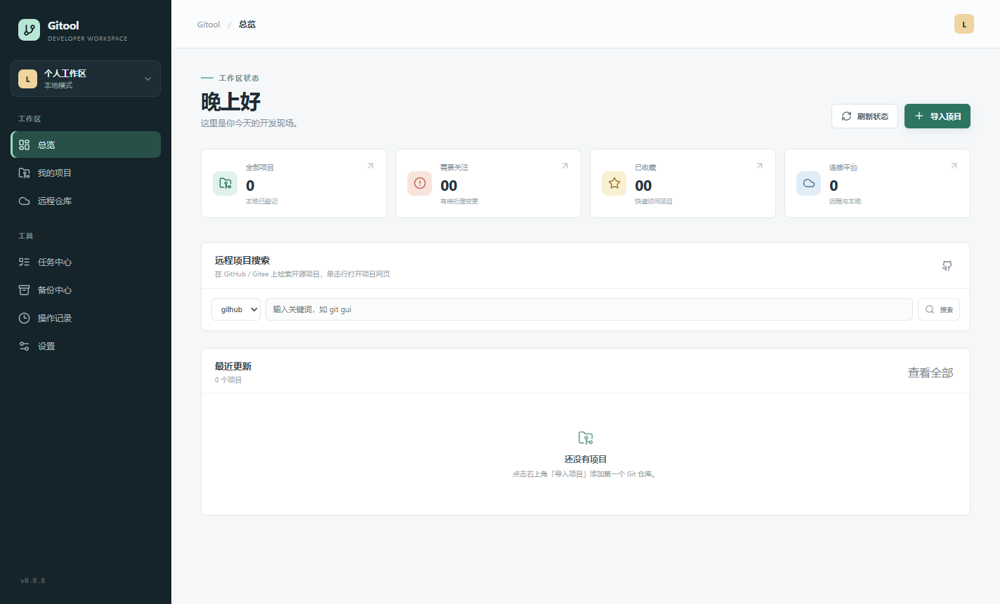
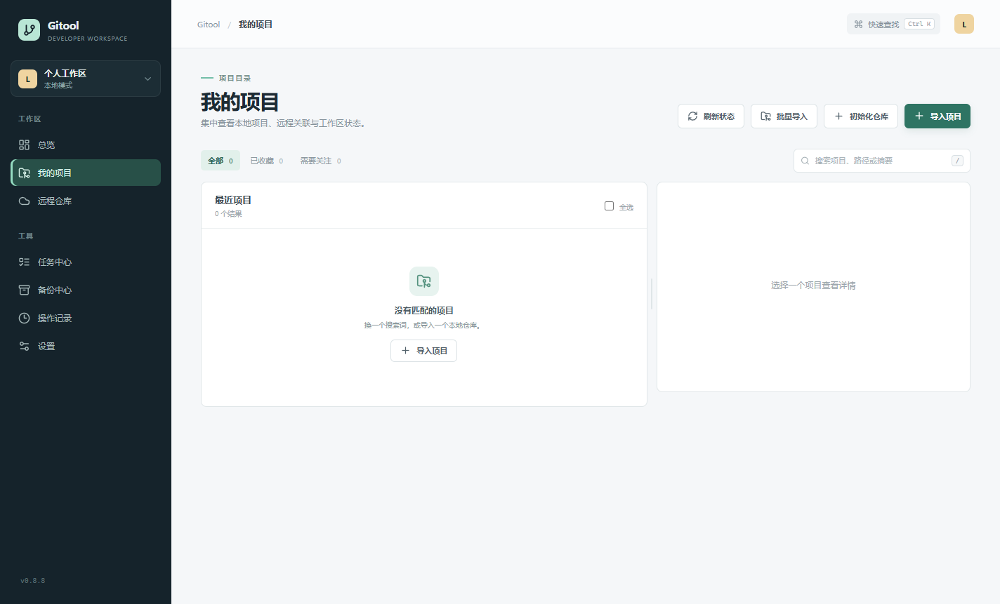

# Gitool GUI 冒烟报告（CDP 驱动 · 隔离用户数据）

| 项目 | 内容 |
| --- | --- |
| 任务 | 团队任务 id=65 / key=`smoke_gui_cdp`（CDP 驱动的 GUI 冒烟） |
| 执行日期 | 2026-11-21 |
| 基线 | `HEAD efda68e`（`fix(git): 恢复变更列表首条并补备份路径白名单（冒烟 P1-1/P1-2）`） |
| 执行方式 | 生产构建 + `electron . --remote-debugging-port=9223 --user-data-dir=<隔离目录>`，用 Node 22 内置 `WebSocket` 手写 CDP 客户端执行 evaluate / 截图 |
| 应用版本 | 0.8.8（`package.json`、UA `Gitool/0.8.8`、bundle 内 `v`+`0.8.8` 三处一致） |
| 运行时 | Windows + PowerShell · Node v22.22.2 · npm 10.9.7 · Electron 44.4.3 · Chrome 152.0.7977.130 · V8 15.2.124.28 |
| 隔离 userdata | 最终轮：`C:\Users\Administrator\AppData\Local\Temp\gitool-gui-smoke\userdata-final`（未读写真实 `%APPDATA%\Gitool`） |
| 业务代码改动 | **无**（`git status` 仅新增 `docs/smoke-artifacts/`，无 src/electron/shared/package.json 变更） |

---

## 1. 方法与判定依据

1. **不引入新依赖**：不装 puppeteer/playwright，仅用 Node 22 内置 `globalThis.WebSocket` 实现 `send(method, params)` + 按 `id` 收响应；脚本全部落在 `%TEMP%\gitool-gui-smoke`，不入库。
2. **事件收集先于 `enable`**：`Runtime.enable` / `Page.enable` / `Log.enable` 之前先挂监听，保证 `exceptionThrown`、`consoleAPICalled`、`Log.entryAdded` 不丢。
3. **验收用断言而非"等一等"**：点击导航后以 50ms 间隔轮询 `/active nav` 文本并断言切换成功（实测 58ms），再额外观察 2s 确认不回退。
4. **输入来源埋点**：页内捕获阶段监听 `pointerdown/mousedown/click/focusin/keydown`，记录 `isTrusted`，用于区分"应用自身出问题"与"外部输入干扰"（关键作用见第 5 节）。
5. **首启语义**：每轮实验用**全新** `userdata` 目录冷启动，避免上一轮 SQLite/localStorage 残留掩盖首启种子逻辑；首屏截图前轮询等待 bootstrap 完成（工作区名从占位「工作区 / 本地模式」变为「个人工作区」，实测 6274ms，主要由 `environment()` 的 git 探测与三平台网络探测决定）。

> 说明：第一轮曾用 `Page.reload` 在监听开启后复现一次加载过程（用于覆盖冷启动渲染期错误）；最终轮改为全新 userdata 冷启动直采，无需 reload，截图与结论以最终轮为准。

---

## 2. 构建结果

```
npm run build   → EXITCODE=0
tsc -b && vite build
dist/index.html                   0.75 kB │ gzip:   0.42 kB
dist/assets/index-WRc0q17G.css   54.28 kB │ gzip:  10.07 kB
dist/assets/index-BH1eGyIr.js   458.84 kB │ gzip: 149.18 kB
dist-electron/main.cjs          177.98 kB │ gzip:  53.49 kB
dist-electron/preload.cjs         4.21 kB │ gzip:   1.23 kB
✓ built in 473ms / 178ms / 15ms
```

产物时间戳 `2026/11/21 23:04:35`，与 `package.json` version `0.8.8` 一致。

---

## 3. 逐步结果（a ~ g + 截图 + 清理）

| 步骤 | 检查项 | 期望 | 实际 | 判定 |
| --- | --- | --- | --- | --- |
| a | `document.title` | `Gitool` | `Gitool` | ✅ |
| b | `document.body.innerText.slice(0,800)` | 首屏可读、导航与空态齐全 | 见下方摘录（总览页，工作区「个人工作区」，0 项目空态引导） | ✅ |
| c | `Object.keys(window.gitool \|\| {}).length` | 80 | **80**；`typeof window.gitool === "object"`；样例：`environment, refreshEnvironment, installGit, onInstallProgress, selectDirectory, openExternal, openPath, openInEditor, openInTerminal, inspectProject` | ✅ |
| d | `await window.gitool.environment()` | 真实主进程环境 | `git_available=true`，`git_version="git version 2.56.1.windows.1"`，`platform="win32"`，`data_directory=<隔离 userdata-final>`，`data_directory_writable=true`，`keyring_available=true`，`network={github:"reachable", gitee:"unreachable", gitlab:"unreachable"}` | ✅ |
| e | `await window.gitool.listWorkspaces()` | 首启自动种子 1 个默认工作区 | `[{ id:"default", name:"个人工作区", createdAt:"2026-11-21T15:12:31.744Z", updatedAt: 同 }]`（进程启动 15:12:31.1，即启动即种子） | ✅ |
| f | 文本匹配点击侧栏「我的项目」 | `CLICKED` 且真正切页 | 返回 `CLICKED`（`BUTTON`，`innerText="我的项目"`）；`active nav` 在 **58ms** 内变为「我的项目」 | ✅ |
| g | 等待 800ms 后 `body.innerText.slice(0,800)` | 切到我的项目页 | 面包屑 `Gitool / 我的项目`；`h1="我的项目"`；正文见下方摘录 | ✅ |
| — | 稳定性（点击后 +2s） | 不回退 | `active="我的项目"`，`h1="我的项目"` | ✅ |
| — | 截图 ×2 | PNG 落盘 | `gui-01-home.png` 53,209 B；`gui-02-projects.png` 48,798 B | ✅ |
| — | 清理 | 无残留进程 / 端口 | `Browser.close` 生效；`Get-Process electron` 空；`Get-NetTCPConnection -LocalPort 9223` 仅 `TimeWait`（`OwningProcess=0`，无 `Listen`） | ✅ |

### 3.1 首屏文本（步骤 b 摘录）

```
Gitool / DEVELOPER WORKSPACE / L / 个人工作区 / 本地模式
工作区：总览 · 我的项目 · 远程仓库　工具：任务中心 · 备份中心 · 操作记录 · 设置 · v0.8.8
Gitool / 总览
工作区状态 / 晚上好 / 这里是你今天的开发现场。  [刷新状态] [导入项目]
全部项目 0（本地已登记）｜需要关注 00（有待处理变更）｜已收藏 00
快速访问项目 / 连接平台 0（远程与本地）
远程项目搜索：在 GitHub / Gitee 上检索开源项目，单击行打开项目网页（github / gitee / 搜索）
最近更新 0 个项目 · 查看全部
还没有项目 —— 点击右上角「导入项目」添加第一个 Git 仓库。
```

### 3.2 切页后文本（步骤 g 摘录）

```
Gitool / 我的项目
快速查找 Ctrl K
项目目录 / 我的项目 / 集中查看本地项目、远程关联与工作区状态。
[刷新状态] [批量导入] [初始化仓库] [导入项目]
全部 0 · 已收藏 0 · 需要关注 0 / 搜索项目、路径或摘要
最近项目 / 0 个结果 / 全选
没有匹配的项目 —— 换一个搜索词，或导入一个本地仓库。
[+ 导入项目]　选择一个项目查看详情
```

---

## 4. 异常清单

### 4.1 渲染层（CDP 事件）

| 事件类型 | 条数 | 内容 |
| --- | --- | --- |
| `Runtime.exceptionThrown`（未捕获异常） | **0** | — |
| `Runtime.consoleAPICalled`（含 error/warn） | **0** | 全程无任何 console 调用 |
| `Log.entryAdded`（浏览器日志，含网络/安全告警） | **0** | — |

四轮实验（含 `Page.reload` 复现加载、全新 userdata 冷启动）均为 0/0/0。

### 4.2 已知无害告警（单列，不计为缺陷）

| 来源 | 原文 | 判定 |
| --- | --- | --- |
| 应用 stderr | `DevTools listening on ws://127.0.0.1:9223/devtools/browser/...` | 启用远程调试端口的正常输出 |
| 应用 stderr | `(node:18540) Warning: Setting the NODE_TLS_REJECT_UNAUTHORIZED environment variable to '0' makes TLS connections and HTTPS requests insecure...` | **来自宿主环境**：当前 shell `$env:NODE_TLS_REJECT_UNAUTHORIZED=0`；仓库 `src/electron/shared` 中对其零引用（grep 0 命中）。建议正式验收时清除该变量后再跑一次，以排除 TLS 校验相关的环境噪声 |
| environment 网络探测 | 首轮 `github/gitee/gitlab` 全 `unreachable`；最终轮 `github=reachable`、`gitee/gitlab=unreachable`（本机 `Invoke-WebRequest https://github.com` 返回 200） | 环境网络抖动 + 目标站点可达性差异，非应用缺陷；但说明 `environment()` 的网络探测会显著拖慢首启 bootstrap（本轮 6274ms） |

---

## 5. 一度可疑但未复现的现象（留痕，非缺陷判定）

**现象**：第一轮（隔离 userdata 首启 + `Page.reload` 后执行 evaluate）中，点击侧栏「我的项目」返回 `CLICKED`，但 800ms 后页面文本与面包屑仍为「总览」；第二轮（复用同一 userdata 重启）则观察到激活项在无人操作下从「远程仓库」→「我的项目」→「远程仓库」→「任务中心」跳动，形似"自行漂移"。

**复现尝试（4 次，全部正常）**：

| # | 场景 | 结果 |
| --- | --- | --- |
| 1 | 全新 `userdata-fresh` 冷启动，导航渲染后 365ms 即点击「我的项目」 | `CLICKED`，100ms 内切换，持续采样 **10s** 稳定（含 bootstrap 在 5.1s 完成时刻，视图未被覆盖） |
| 2 | 同一进程，点击后 5s 高频事件 trace | 仅 1 条自身脚本点击（`isTrusted=false`），视图稳定 5s |
| 3 | 埋点后**主动断开 CDP 静默 30s**（完全无人操作） | 输入事件 **0 条**，视图 30s 内 **零变化** → 应用自身不会漂移 |
| 4 | 精确复刻第一轮时序（`Page.reload` → 1.2s → `environment()` → `listWorkspaces()` → 点击） | `CLICKED`，持续采样 8.2s 稳定在「我的项目」，0 异常 |

**根因证据（决定性）**：最终轮埋点抓到 3 条 **`isTrusted=true`** 的真实鼠标事件，落点为 `HEADER[Gitool / 总览]`：

```
pointerdown  trusted=true  target=HEADER[Gitool / 总览 ]   t=...953393
mousedown    trusted=true  target=HEADER[Gitool / 总览 ]   t=...953393
click        trusted=true  target=HEADER[Gitool / 总览 ]   t=...953476
click        trusted=false target=BUTTON[我的项目]          t=...963258  ← 本脚本点击
```

脚本点击 `isTrusted=false`，而这批事件 `isTrusted=true`，只可能来自**真实鼠标输入**。说明该桌面环境下存在外部人手/外部自动化在本应用窗口上点击，足以解释第 1、2 轮观察到的视图跳变（点击被外部点击"抢走"目标，或外部点击直接切换了导航）。

**结论**：判定为**测试环境的外部输入干扰**，非应用缺陷；导航点击链路本身经 4 次独立实验验证正常。建议在无人值守时段（关闭其它自动化/远程桌面输入）复核一次以彻底排除。

---

## 6. 截图

首屏（总览，全新首启完成 bootstrap 后、任何交互之前，2×2 卡片空态与「还没有项目」引导完整、无裁切）：



切页后（点击「我的项目」，侧栏该项深色高亮、面包屑 `Gitool / 我的项目`、列表空态 + 右侧详情占位）：



> 两份截图均为 `Page.captureScreenshot(format: png)` 原始 base64 解码落盘，未做任何裁剪/压缩。

---

## 7. 结论

| 验收项 | 结论 | 依据 |
| --- | --- | --- |
| 界面是否正常渲染 | **正常** | 首屏与切页两态文本、布局、空态、导航高亮均正确；截图核对无白屏/无裁切/无错位 |
| 首启流程是否可用 | **可用** | 全新 userdata 冷启动即种子 `id=default「个人工作区」`；git 可用故未弹首启引导模态；空态引导指向「导入项目」路径合理 |
| preload 桥是否完整 | **完整（80/80）** | `window.gitool` 为 object，键数 80；`environment()` / `listWorkspaces()` 返回的是真实主进程数据（隔离数据目录、真实 git 版本），证明 IPCMain 通道打通而非桩数据 |
| 是否有主进程/渲染层错误 | **无** | 0 未捕获异常 / 0 console 调用 / 0 浏览器 Log 条目；stderr 仅 DevTools 与宿主环境 TLS 告警 |
| 导航点击 | **正常** | 58ms 完成切换并保持稳定；第一轮疑似失败经 4 次复现 + `isTrusted` 证据归因于外部输入 |
| 隔离性与清理 | **合规** | `data_directory` 指向 `%TEMP%\gitool-gui-smoke\userdata-final`；`Browser.close` 后 electron 进程 0 残留、9223 无监听；未触碰真实 `%APPDATA%\Gitool`；业务代码零改动 |

**总体判定：通过（PASS）**。唯一需要跟进的是环境侧噪声（`NODE_TLS_REJECT_UNAUTHORIZED=0` 与外部鼠标输入），与产品代码无关。

---

## 8. 局限（本次未覆盖）

1. **原生对话框**：`dialog.showOpenDialog`（导入/扫描目录）、`window.confirm`（删除工作区/移除项目）等需人工点击的系统级 UI，CDP 无法驱替。
2. **系统托盘**：托盘菜单与关闭到托盘行为未验证。
3. **更新链路**：检查更新/下载/安装（`useUpdater`）未执行，涉及外网与安装包写入。
4. **真实 keyring**：`@napi-rs/keyring` 仅读到 `keyring_available=true`，未做 token 存取读写验证。
5. **Git 业务链路**：未在真实仓库上执行 inspect/fetch/pull/push/commit（该部分由 IPC 级冒烟 `docs/smoke-2026-11-21.md` 覆盖）。
6. **交互深度**：未覆盖多工作区切换、搜索/筛选/标签过滤、项目详情各 Tab、任务运行、备份恢复。
7. **视觉**：截图在无缩放（devicePixelRatio 默认）下拍摄，与高分屏/系统缩放/HDR 下的实际观感可能有差异。

---

## 9. 执行留痕

- 临时脚本（**不入库**，位于 `%TEMP%\gitool-gui-smoke`）：`cdp.mjs`（首轮全流程）、`probe.mjs`（点击行为探针）、`trace.mjs` / `trace2.mjs` / `trace3.mjs`（输入事件与静默观察）、`probe4.mjs`（首启竞态）、`probe5.mjs`（reload 时序复刻）、`final.mjs`（最终轮）。
- 结果数据：同目录 `results.json`、`results-final.json`、`probe*.json`、`trace*.json`；应用日志 `logs\app*.log`。
- 进程记录：首轮 PID 33760、次轮 37192、探针轮 38324、最终轮 18540，均已按 PID 树终止；启动前基线无 electron 进程（差集 = 本次全部，无用户进程被误杀）。
- 入库产物：`docs/smoke-artifacts/gui-01-home.png`、`docs/smoke-artifacts/gui-02-projects.png`、本报告。